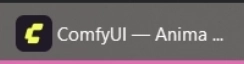

# ComfyUI-Indicator

###
The extension adds a color indicator on taskbar button for when generation is complete in Comfy Desktop for Windows (not a progress indicator).



## Installation

```bash
cd ComfyUI/custom_nodes
git clone https://github.com/Lariany-Yana/ComfyUI-Indicator.git
```
OR
```bash
comfy node install comfyui-indicator
```